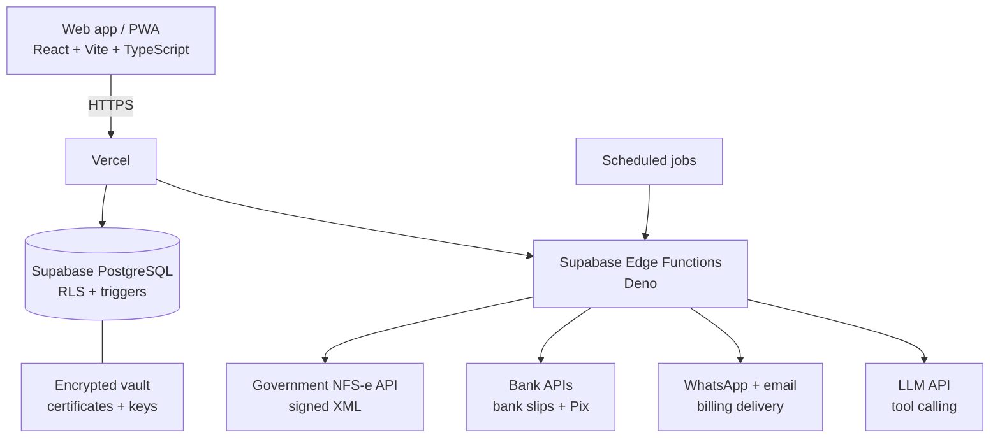
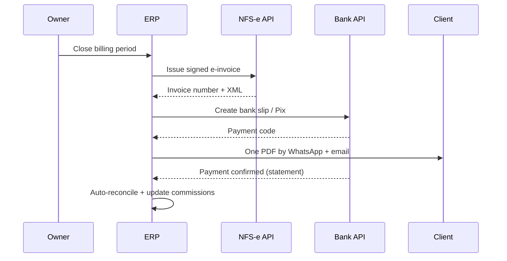

# Fleet Care ERP — AI-built finance automation for a fleet-services business

Production ERP for a B2B truck-care company, built by **orchestrating AI coding agents** (Claude Code, OpenAI Codex, subagents, MCP).

**In daily use since Sep 2026 · 150+ merged pull requests · 200+ versioned releases**

## The problem
Billing was manual: collecting service records, issuing government e-invoices, generating bank slips, matching payments and calculating staff commissions took **about 3 days per cycle**.

## The result
- Billing cycle cut from **3 days to 1 hour**
- Payments matched automatically against card and bank statements
- Commissions recalculate by themselves whenever a service record changes

## Features
- **Government e-invoicing (NFS-e):** XML generation, X.509 digital-certificate signature, cancellation events, hourly sync with the national API, multiple issuers
- **Payments:** bank-slip API integration, Pix, card-terminal reconciliation, OFX bank-statement parser with automatic matching, split payments
- **Automated billing:** service report + invoice + bank slip in one PDF, sent by WhatsApp and email
- **Commissions:** PostgreSQL triggers keep staff commissions in sync; staff earnings portal
- **AI owner assistant:** LLM with tool calling over business data
- **SaaS mode:** guided bank onboarding, subscriptions, demo mode with an in-memory database
- **Security:** Row Level Security, encrypted vault for certificates, PWA push notifications

## Architecture

## Billing flow

## How it was built
Specs → plans → parallel AI subagents in git worktrees → automated tests and code-review agents → human review → automatic deploy on every merge.

## Stack
React · Vite · TypeScript · Supabase (PostgreSQL, Edge Functions/Deno, RLS, cron) · Vercel · Cloudflare · LLM APIs · WhatsApp API

> Source code is private (real client, tax and financial data). Architecture walkthrough and live demo available on request.
